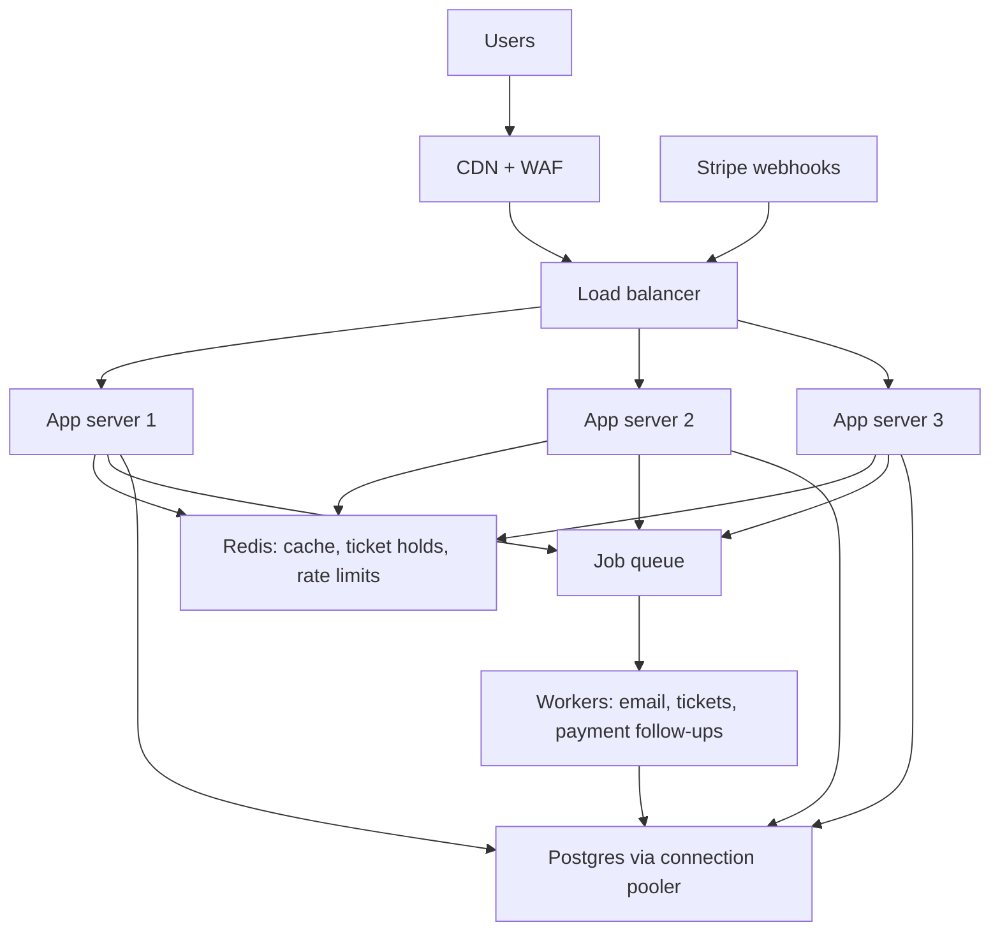

# Scaling the Event Booking API: design notes

Status: draft. Anything marked **TBD** is a number or result I have to measure myself and fill in. Do not publish this with TBDs left in.

Live project: booking.abdulsamadchishti.dev

## 1. Goal

"100K users" is not a target. Pick measurable ones and write them here.

| Metric                                       | Target     | Measured |
| -------------------------------------------- | ---------- | -------- |
| Read throughput (event list/detail)          | TBD req/s  | TBD      |
| p95 latency for reads                        | TBD ms     | TBD      |
| Concurrent buyers on the same scarce tickets | TBD        | TBD      |
| Oversold tickets                             | 0          | TBD      |
| Error rate under load                        | under TBD% | TBD      |

Rough conversion to remember: concurrent users is not requests per second. If each user sends one request every 10-30 seconds, 100K concurrent users is about 3,000-10,000 req/s. Define which one I mean.

## 2. Architecture

Corrections to my first sketch:

- Redis is a side lookup for the app, not a layer every request passes through on the way to the database.
- Payment and background work are not "after the database". Stripe calls my webhook endpoint, and workers pull jobs from a queue.
- CDN, WAF and load balancer are three different things. A CDN only helps with cacheable responses (static files, maybe public event listings). Most API responses are dynamic.
- Three app servers on one VPS demonstrate load balancing. They do not add capacity beyond that one machine.

## 3. Read path vs write path

My first assumption was "we are only reading, sellers write rarely". That is wrong for a ticketing system.

- **Read path** (browse events): easy to scale. Cache it.
- **Write path** (reserve, pay, confirm): this is where the system breaks. Many buyers write at once, and they all want the same rows (remaining tickets for a popular event).

The write path is the core of this project.

## 4. Caching (read path)

Pattern: cache-aside.

1. App checks Redis for the event.
2. On a hit, return it.
3. On a miss, read from Postgres, store in Redis with a TTL, return it.

Things to get right:

- **Invalidation:** when a seller edits an event, delete or update the cache key. A TTL alone shows stale data.
- **Ticket availability:** do not serve counts from a TTL cache. Stale counts cause overselling or a confusing UI. Use an authoritative source (Postgres or an atomic Redis counter).
- **Cache stampede:** when a very popular key expires, many requests hit Postgres at once. Mitigations: lock so one request refills the key, add jitter to TTLs, or serve stale while refreshing.
- **Cache penetration:** repeated requests for non-existent IDs bypass the cache. Cache "not found" briefly or validate IDs first.

## 5. Booking correctness (write path)

Goal: if 200 buyers try to buy the last 20 tickets, exactly 20 succeed and nobody is charged for a ticket that does not exist.

Options to compare (TBD: which one I chose and why):

1. **Row lock:** `SELECT ... FOR UPDATE` on the ticket inventory row inside a transaction. Simple and correct, but contended rows serialize.
2. **Atomic conditional update:** `UPDATE ... SET remaining = remaining - 1 WHERE remaining > 0` and check the rows affected. Often simpler than locking.
3. **Reservation hold with expiry:** reserve tickets for a short time while the buyer pays, then release them if payment does not complete.
4. **Unique constraints** where an item can only be bought once (for example a specific seat).

Also:

- **Idempotency keys** so a retried request or a duplicated webhook does not create two orders.
- **Stripe webhooks:** verify the signature, treat events as at-least-once, make handlers idempotent, and return quickly (do slow work in a worker).
- Test the invariant under concurrency, not just in a single request.

## 6. Postgres

- **Connection limits:** several app servers times several workers each can exhaust Postgres connections before CPU runs out. Use a pooler (for example PgBouncer) or sensible pool sizes. TBD: what I used.
- **Indexes:** check hot queries with `EXPLAIN ANALYZE`. TBD: which queries I fixed.
- **N+1 queries:** look for loops that run one query per row.
- **Pagination:** never return an unbounded list.
- Read replicas are a later step, only if measurements show reads are the bottleneck.

## 7. Background work

Move anything slow or retryable out of the request: confirmation emails, ticket PDFs, post-payment follow-ups. The request enqueues a job; a worker processes it. Jobs must be safe to run twice.

## 8. Load testing plan

Tool: k6 or Locust. Run against a staging copy, not production.

Process:

1. **Baseline:** record p50/p95/p99 latency, error rate, requests per second, CPU, memory, database connections.
2. **Find the bottleneck:** slow queries, connection exhaustion, CPU on the app, cache hit rate.
3. **Change one thing, re-measure.**
4. **Correctness test:** N concurrent buyers on M tickets; assert exactly M succeed.
5. Repeat until the targets in section 1 are met or I can explain what limits the system.

## 9. Results (fill in with real numbers)

| Step | Change                        | Req/s | p95 (ms) | Errors | Notes |
| ---- | ----------------------------- | ----- | -------- | ------ | ----- |
| 0    | Baseline                      | TBD   | TBD      | TBD    |       |
| 1    | Indexes / N+1 fixes           | TBD   | TBD      | TBD    |       |
| 2    | Connection pooling            | TBD   | TBD      | TBD    |       |
| 3    | Redis cache for reads         | TBD   | TBD      | TBD    |       |
| 4    | Background jobs for slow work | TBD   | TBD      | TBD    |       |
| 5    | Multiple app instances        | TBD   | TBD      | TBD    |       |

What limited the system at the end: TBD.

## 10. What I got wrong at first

- Treated "100K users" as a target without defining it.
- Assumed the system was read-only from the buyer's side.
- Drew the architecture as a straight pipeline.
- Counted three servers as scaling when they would share one machine.

Misses pile up. If a popular event’s key expires and 2,000 requests arrive at once, all 2,000 see a miss and all go to Postgres. That’s the stampede from the notes. Fix it with a lock so one request refills the key while the others wait or get slightly stale data.

Writes go to Postgres first, then you delete the Redis key. When a seller edits an event, update the database, then delete the cached key. The next read refills it. Don’t update both in parallel, or they drift apart.

If Redis goes down, the app falls back to Postgres and takes the full read load. Decide ahead of time what happens: rate limits, a smaller fallback, or failing gracefully. Don’t find out during a spike.

## 11. Interview questions I should be able to answer

- How do you prevent two buyers from getting the last ticket?
- What is cache-aside, and how do you invalidate it correctly?
- What is a cache stampede and how do you prevent it?
- Why can Postgres run out of connections before it runs out of CPU?
- Why does a webhook handler need to be idempotent?
- What does a CDN actually help with in an API?
- How did you decide what to optimize first?
